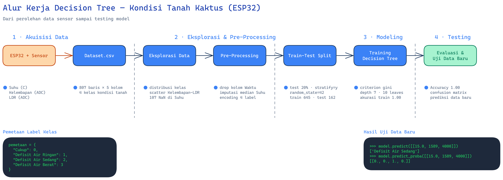
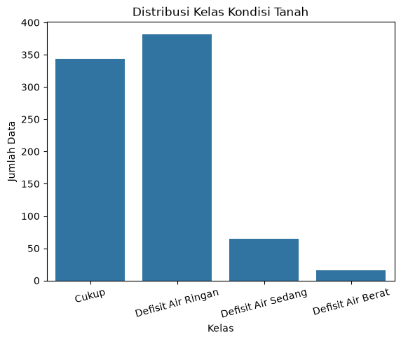
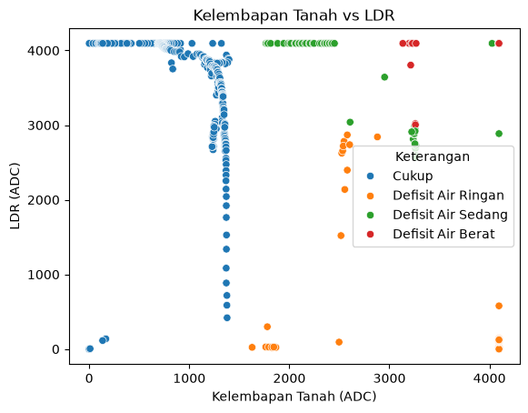
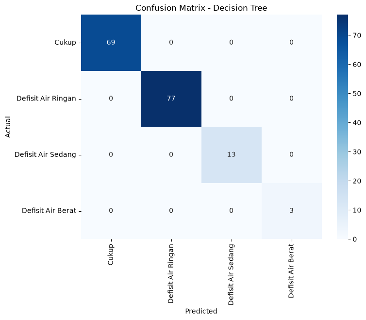
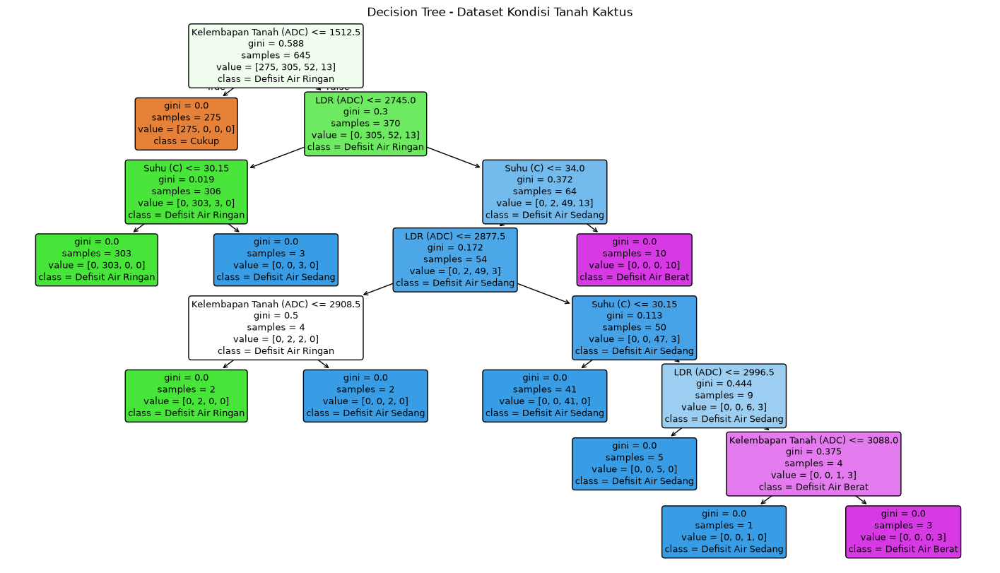
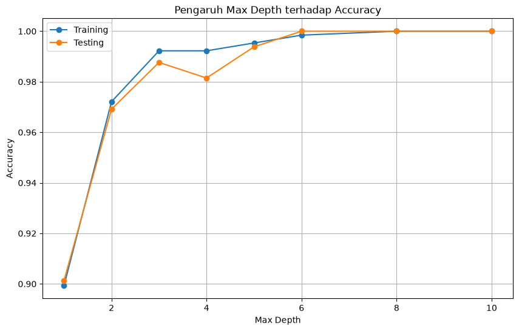

# 🌵 decision-in-esp32 — Klasifikasi Kondisi Tanah Kaktus dengan Decision Tree

Model **Decision Tree** yang dilatih dari data sensor ESP32 untuk memprediksi empat kelas kondisi tanah kaktus: **Cukup**, **Defisit Air Ringan**, **Defisit Air Sedang**, dan **Defisit Air Berat**. Seluruh pipeline — mulai dari perolehan data sensor, eksplorasi, pre-processing, pelatihan, evaluasi, hingga pengujian data baru — tersedia dalam satu notebook [`UTS.ipynb`](UTS.ipynb).

| | |
|---|---|
| **Dataset** | 807 baris hasil pencatatan sensor (3 fitur + waktu + label) |
| **Algoritma** | `DecisionTreeClassifier` (criterion `gini`, `random_state=42`) |
| **Akurasi** | 1.00 (train & test) |
| **Struktur pohon** | Depth 7 · 10 leaf |
| **Tools** | Python · pandas · scikit-learn · matplotlib · seaborn · Jupyter |

---

## 📖 Daftar Isi

1. [Struktur Repositori](#-struktur-repositori)
2. [Memulai](#-memulai)
3. [Alur Kerja](#-alur-kerja)
4. [Tahap 1 — Perolehan Data (Akuisisi)](#-tahap-1--perolehan-data-akuisisi)
5. [Tahap 2 — Eksplorasi Data](#-tahap-2--eksplorasi-data)
6. [Tahap 3 — Pre-Processing](#-tahap-3--pre-processing)
7. [Tahap 4 — Train-Test Split](#-tahap-4--train-test-split)
8. [Tahap 5 — Training Decision Tree](#-tahap-5--training-decision-tree)
9. [Tahap 6 — Evaluasi & Interpretasi Hasil](#-tahap-6--evaluasi--interpretasi-hasil)
10. [Tahap 7 — Overfitting & Eksperimen max_depth](#-tahap-7--overfitting--eksperimen-max_depth)
11. [Tahap 8 — Uji Data Baru](#-tahap-8--uji-data-baru)
12. [Menggunakan Model Tersimpan](#-menggunakan-model-tersimpan)
13. [Artefak Gambar & Model](#-artefak-gambar--model)

---

## 🗂️ Struktur Repositori

```text
decision-in-esp32/
├── Dataset.csv                          # Data mentah sensor (807 baris × 5 kolom)
├── UTS.ipynb                            # Notebook: seluruh pipeline end-to-end
├── data acquisitioning.jpeg             # Foto rig akuisisi: sensor pada pot tanaman
├── data acquisitioning (1).jpeg         # Foto rig akuisisi: ESP32 + breadboard + laptop
├── images/                              # Gambar hasil notebook & diagram alur
│   ├── alur-kerja.png                   # Diagram alur pipeline (akuisisi → testing)
│   ├── 01-distribusi-kelas.png          # Countplot distribusi 4 kelas
│   ├── 02-scatter-kelembapan-ldr.png    # Scatter kelembapan vs LDR
│   ├── 03-confusion-matrix.png          # Confusion matrix model
│   ├── 04-visualisasi-decision-tree.png # Struktur pohon keputusan
│   └── 05-eksperimen-max-depth.png      # Grafik pengaruh max_depth
├── model/                               # Artefak model hasil notebook
│   ├── decision_tree_kondisi_tanah.pkl  # Model terlatih (joblib)
│   ├── class_mapping.json               # Pemetaan label → kode + metadata model
│   └── tree_rules.txt                   # Aturan keputusan pohon (export_text)
└── diagram/
    └── alur-kerja-interaktif.html       # Diagram alur interaktif (buka di browser)
```

---

## 🚀 Memulai

### Prasyarat

- Python 3.10+ (direkomendasikan 3.11/3.12)
- pip / conda

### Instalasi

```bash
git clone https://github.com/ILoveTahuTek/decision-in-esp32.git
cd decision-in-esp32
pip install numpy pandas matplotlib seaborn scikit-learn jupyter joblib
```

### Menjalankan Notebook

```bash
jupyter notebook UTS.ipynb
```

Jalankan sel dari atas ke bawah secara berurutan (Kernel → Restart & Run All). Notebook tidak memerlukan koneksi internet; semua sel akan mereproduksi hasil yang sama karena `random_state` dikunci di `42`.

---

## 🔄 Alur Kerja

Pipeline lengkap dari perolehan data sampai testing:



Versi **interaktif** diagram ini tersedia di [`diagram/alur-kerja-interaktif.html`](diagram/alur-kerja-interaktif.html) — unduh file tersebut lalu buka langsung di browser untuk menjelajahi tiap tahapan (mendukung tema gelap/terang, pan/zoom, dan penelusuran jalur).

Pemetaan tahapan notebook ke bagian panduan ini:

| Langkah di Notebook | Isi | Bagian |
|---|---|---|
| 01–02 | Import library & tarik dataset | [Tahap 1](#-tahap-1--perolehan-data-akuisisi) |
| 03 | Eksplorasi data (EDA) | [Tahap 2](#-tahap-2--eksplorasi-data) |
| 04–05 | Pre-processing & definisi X, y | [Tahap 3](#-tahap-3--pre-processing) |
| 06 | Train-test split | [Tahap 4](#-tahap-4--train-test-split) |
| 07 | Membangun model Decision Tree | [Tahap 5](#-tahap-5--training-decision-tree) |
| 08–09 | Visualisasi pohon & pengamatan overfitting | [Tahap 6–7](#-tahap-6--evaluasi--interpretasi-hasil) |
| 10 | Eksperimen `max_depth` | [Tahap 7](#-tahap-7--overfitting--eksperimen-max_depth) |
| 11 | Uji coba data baru | [Tahap 8](#-tahap-8--uji-data-baru) |

---

## 📡 Tahap 1 — Perolehan Data (Akuisisi)

Data dikumpulkan dari ESP32 yang membaca tiga sensor secara berkala: sensor **suhu** (°C), sensor **kelembapan tanah** (keluaran ADC 0–4095), dan **LDR** intensitas cahaya (keluaran ADC). Setiap pembacaan dicatat bersama waktu pengukuran ke dalam [`Dataset.csv`](Dataset.csv), menghasilkan **807 baris data** dengan lima kolom:

| Kolom | Tipe | Makna |
|---|---|---|
| `Waktu` | teks timestamp | Waktu pencatatan data (dibuang saat pre-processing) |
| `Suhu (C)` | numerik | Suhu udara sekitar dalam °C (memiliki 107 nilai hilang) |
| `Kelembapan Tanah (ADC)` | integer | Semakin besar nilai → semakin kering tanah |
| `LDR (ADC)` | integer | Semakin besar nilai → semakin terang cahaya |
| `Keterangan` | teks | Label kondisi tanah (target klasifikasi) |


Label `Keterangan` tidak ditentukan secara manual, melainkan mengikuti **aturan sistem poin** tiga sensor: setiap sensor diberi poin 0–2 sesuai ambang batasnya, lalu total poin menentukan kelasnya.

| Sensor | Poin 0 | Poin 1 | Poin 2 |
|---|---|---|---|
| Kelembapan tanah (ADC) | Basah (< 1500) | Lembap (1500 – < 3000) | Kering (≥ 3000) |
| Suhu (°C) | Sejuk (< 30) | Hangat (30 – < 35) | Panas (≥ 35) |
| LDR (ADC) | Redup (< 1000) | Sedang (1000 – < 3000) | Terang (≥ 3000) |

Keterangan akhir ditentukan dari total poin ketiga sensor:

| Kondisi | Keterangan |
|---|---|
| Tanah basah (poin kelembapan 0) | `Cukup` |
| Total poin 1 – 2 | `Defisit Air Ringan` |
| Total poin 3 – 4 | `Defisit Air Sedang` |
| Total poin 5 – 6 | `Defisit Air Berat` |

Distribusi label yang dihasilkan:

| Keterangan | Jumlah Data |
|---|---|
| Defisit Air Ringan | 382 |
| Cukup | 344 |
| Defisit Air Sedang | 65 |
| Defisit Air Berat | 16 |

Perlu diperhatikan bahwa data ini **tidak seimbang** — kelas `Defisit Air Berat` hanya 16 baris (≈2%), karena kondisi kering ekstrem jarang terjadi selama periode pencatatan. Ketidakseimbangan ini diantisipasi dengan `stratify` saat pembagian data (lihat [Tahap 4](#-tahap-4--train-test-split)).

---

## 🔍 Tahap 2 — Eksplorasi Data

Notebook memeriksa dimensi data (`df.shape` → `(807, 5)`), tipe kolom (`df.info()`), statistik ringkas (`df.describe()`), dan nilai hilang (`df.isnull().sum()`). Temuan utama: hanya kolom `Suhu (C)` yang memiliki nilai hilang, yaitu **107 dari 807 baris**, sedangkan kolom lain lengkap.



Countplot di atas menegaskan ketidakseimbangan kelas: dua kelas dominan (`Defisit Air Ringan` dan `Cukup`) jauh lebih banyak daripada dua kelas defisit berat. Hubungan antar fitur divisualisasikan dengan scatter plot berikut:



Terlihat pola pemisahan yang cukup jelas: kelas `Cukup` terkonsentrasi pada nilai kelembapan rendah (tanah basah), sementara kelas defisit menyebar ke nilai kelembapan tinggi. Pola yang hampir dapat dipisahkan secara linear seperti ini adalah sinyal awal bahwa Decision Tree akan bekerja sangat baik pada dataset ini.

---

## 🧹 Tahap 3 — Pre-Processing

Tiga langkah pembersihan dijalankan berurutan:

1. **Buang kolom `Waktu`** — timestamp hanya penanda pencatatan, tidak punya nilai prediktif terhadap kondisi tanah.
2. **Imputasi nilai hilang `Suhu (C)` dengan median** — `SimpleImputer(strategy='median')` dipilih karena median tahan terhadap outlier, sehingga 107 nilai kosong terisi tanpa menggeser distribusi data.
3. **Label encoding target** — label teks dipetakan ke angka sesuai tingkat keparahan defisit air:

| Keterangan | Kode |
|---|---|
| Cukup | 0 |
| Defisit Air Ringan | 1 |
| Defisit Air Sedang | 2 |
| Defisit Air Berat | 3 |

Pemetaan ini juga tersimpan dalam [`model/class_mapping.json`](model/class_mapping.json) agar prediksi angka dari model selalu bisa diterjemahkan kembali ke nama kelas. Setelah tahap ini, dataset siap dipisah menjadi:

- **X (fitur)**: `Suhu (C)`, `Kelembapan Tanah (ADC)`, `LDR (ADC)` → shape `(807, 3)`
- **y (target)**: `Keterangan_Encoded` → shape `(807,)`

---

## ⚖️ Tahap 4 — Train-Test Split

```python
X_train, X_test, y_train, y_test = train_test_split(
    X, y,
    test_size=0.2,      # 20% data untuk pengujian
    random_state=42,    # hasil split selalu sama (reproduksibel)
    stratify=y          # proporsi 4 kelas dijaga di train & test
)
```

Hasil pembagian:

| Subset | Jumlah Baris |
|---|---|
| `X_train` / `y_train` | 645 |
| `X_test` / `y_test` | 162 |

Dua parameter di atas krusial. `stratify=y` memastikan proporsi kelas yang timpang tetap terjaga di kedua subset — tanpa ini, kelas minoritas seperti `Defisit Air Berat` bisa saja tidak muncul sama sekali di data uji. Sementara `random_state=42` menjamin siapa pun yang menjalankan notebook akan mendapatkan split yang identik, sehingga hasil akurasi 1.00 dapat direproduksi.

---

## 🌳 Tahap 5 — Training Decision Tree

```python
dt_model = DecisionTreeClassifier(criterion="gini", random_state=42)
dt_model.fit(X_train, y_train)
y_pred_dt = dt_model.predict(X_test)
```

Model memakai kriteria **Gini impurity** untuk memilih fitur dan titik potong terbaik pada setiap percabangan. Setelah `fit()`, model mempelajari serangkaian aturan if-then dari 645 data latih; prediksi terhadap 162 data uji menghasilkan akurasi **1.00** — semua sampel uji diklasifikasikan benar.

---

## 📊 Tahap 6 — Evaluasi & Interpretasi Hasil

Classification report per kelas (data uji, 162 sampel):

| Kelas | Precision | Recall | F1-Score | Support |
|---|---|---|---|---|
| Cukup | 1.00 | 1.00 | 1.00 | 69 |
| Defisit Air Ringan | 1.00 | 1.00 | 1.00 | 77 |
| Defisit Air Sedang | 1.00 | 1.00 | 1.00 | 13 |
| Defisit Air Berat | 1.00 | 1.00 | 1.00 | 3 |



**Interpretasi confusion matrix.** Semua nilai terkonsentrasi di diagonal — tidak ada satu pun sampel yang salah kelas. Namun hasil ini perlu dibaca dengan hati-hati: dua kelas minoritas hanya diuji dengan sangat sedikit sampel (`Defisit Air Sedang` 13 dan `Defisit Air Berat` 3), sehingga metrik 1.00 pada kelas tersebut memiliki ruang kesalahan yang nyaris nol sejak awal dan belum tentu mencerminkan performa pada data dunia nyata. Sebaliknya, untuk kelas dominan (`Cukup` 69 dan `Defisit Air Ringan` 77), akurasi sempurna jauh lebih informatif karena diuji pada sampel yang cukup besar.

---

## ⚠️ Tahap 7 — Overfitting & Eksperimen max_depth

Pengamatan overfitting pada model dasar:

| Properti | Nilai |
|---|---|
| Kedalaman pohon (`get_depth()`) | 7 |
| Jumlah leaf (`get_n_leaves()`) | 10 |
| Training accuracy | 1.00 |
| Testing accuracy | 1.00 |

Training dan testing accuracy yang sama-sama 1.00 **bukan** tanda overfitting klasik (overfitting ditandai train tinggi tetapi test jauh lebih rendah). Namun kedalaman 7 dengan 10 leaf patut dicermati strukturnya:



Pohon menempatkan **`Kelembapan Tanah (ADC) <= 1512.5` sebagai akar keputusan** — satu pertanyaan saja sudah memisahkan seluruh kelas `Cukup` (275 sampel, gini 0). Cabang kanan kemudian menggabungkan `LDR (ADC)` dan `Suhu (C)` untuk memilah tingkat defisit air. Ini konsisten dengan fisika masalahnya: tanah basah (ADC rendah) memang berarti air cukup, sementara tingkat kekeringan berkorelasi dengan cahaya (evaporasi) dan suhu.

Eksperimen `max_depth` menguji bagaimana batasan kedalaman memengaruhi akurasi:



| max_depth | Train Accuracy | Test Accuracy |
|---|---|---|
| 1 | 0.899 | 0.901 |
| 2 | 0.972 | 0.969 |
| 3 | 0.992 | 0.988 |
| 4 | 0.992 | 0.981 |
| 5 | 0.995 | 0.994 |
| 6 | 0.998 | 1.000 |
| 8 | 1.000 | 1.000 |
| 10 | 1.000 | 1.000 |

**Interpretasi eksperimen.** Bahkan pohon sedalam 1 tingkat (satu keputusan saja) sudah mencapai ~90% akurasi — bukti kuat bahwa `Kelembapan Tanah (ADC)` adalah fitur paling dominan. Akurasi test menembus 1.00 mulai `max_depth=6` dan stabil setelahnya, artinya kedalaman ekstra (7→10) tidak merusak generalisasi. Jika model ini kelak dipakai pada data sensor baru yang lebih bervariasi, membatasi `max_depth=5` atau `6` adalah pilihan aman: struktur pohonnya tetap ringkas untuk dibaca (atau ditanam ke firmware ESP32) dengan penurunan akurasi yang nyaris nol.

---

## 🧪 Tahap 8 — Uji Data Baru

```python
data_baru = pd.DataFrame([[15.0, 1589, 4000]], columns=X.columns)
pred = dt_model.predict(data_baru)
print("Prediksi:", nama_kelas[pred[0]])          # -> Defisit Air Sedang
print(dt_model.predict_proba(data_baru))        # -> [[0. 0. 1. 0.]]
```

Pembacaan sensor baru `Suhu=15.0 °C, Kelembapan=1589 ADC, LDR=4000 ADC` diprediksi **`Defisit Air Sedang`** dengan probabilitas 100% pada kelas tersebut (`[0, 0, 1, 0]`). Masuk akal: kelembapan 1589 ADC sedikit di atas ambang tanah basah (1512), dan LDR 4000 menandakan cahaya sangat terang yang mempercepat evaporasi.

---

## 💾 Menggunakan Model Tersimpan

Model akhir diekspor ke [`model/decision_tree_kondisi_tanah.pkl`](model/decision_tree_kondisi_tanah.pkl) sehingga tidak perlu melatih ulang setiap kali ingin memprediksi:

```python
import joblib
import pandas as pd

model = joblib.load("model/decision_tree_kondisi_tanah.pkl")

data_baru = pd.DataFrame(
    [[15.0, 1589, 4000]],
    columns=["Suhu (C)", "Kelembapan Tanah (ADC)", "LDR (ADC)"]
)
pred = model.predict(data_baru)[0]

# Terjemahkan kode kelas kembali ke nama label
import json
mapping = json.load(open("model/class_mapping.json"))
kelas = list(mapping["pemetaan_label"].keys())
print("Prediksi kondisi tanah:", kelas[pred])
```

Aturan keputusan lengkap pohon tersedia dalam bentuk teks di [`model/tree_rules.txt`](model/tree_rules.txt):

```text
|--- Kelembapan Tanah (ADC) <= 1512.50
|   |--- class: 0                    (Cukup)
|--- Kelembapan Tanah (ADC) >  1512.50
|   |--- LDR (ADC) <= 2745.00
|   |   |--- Suhu (C) <= 30.15
|   |   |   |--- class: 1            (Defisit Air Ringan)
|   |   |--- Suhu (C) >  30.15
|   |   |   |--- class: 2            (Defisit Air Sedang)
|   ...
```

Aturan teks ini juga menjadi titik awal yang praktis jika kondisi tanah ingin diklasifikasikan langsung di firmware ESP32 dengan sejumlah perbandingan if/else sederhana.

---

## 📁 Artefak Gambar & Model

Semua visual dan artefak yang dihasilkan notebook:

| File | Sumber | Deskripsi |
|---|---|---|
| `images/alur-kerja.png` | Diagram alur | Ringkasan visual pipeline akuisisi → testing |
| `images/01-distribusi-kelas.png` | Notebook (sel EDA) | Countplot distribusi 4 kelas kondisi tanah |
| `images/02-scatter-kelembapan-ldr.png` | Notebook (sel EDA) | Scatter `Kelembapan Tanah (ADC)` vs `LDR (ADC)` per kelas |
| `images/03-confusion-matrix.png` | Notebook (sel evaluasi) | Heatmap confusion matrix model |
| `images/04-visualisasi-decision-tree.png` | Notebook (sel visualisasi) | Struktur pohon keputusan lengkap (depth 7) |
| `images/05-eksperimen-max-depth.png` | Notebook (sel eksperimen) | Grafik train/test accuracy terhadap `max_depth` |
| `model/decision_tree_kondisi_tanah.pkl` | Notebook (training) | Model terlatih siap pakai (joblib) |
| `model/class_mapping.json` | Notebook (training) | Pemetaan label ↔ kode kelas + metadata model |
| `model/tree_rules.txt` | Notebook (training) | Aturan keputusan pohon dalam teks |
